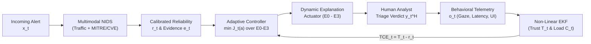

# Trust-in-AI-Driven-Security-Operations
### Human-Centric Trust Calibration and Adaptive Explainability in AI-Driven Security Operations

[](https://www.python.org/downloads/)
[](https://pytorch.org/)
[](LICENSE)
[]()
[-orange.svg)]()

> **Authors:** Pierluigi Dell'Acqua, Francesco La Rosa, and Massimo Villari  
> *Department of Mathematical and Computer Sciences, Physical Sciences and Earth Sciences, University of Messina, Italy*

---

## 📋 Overview

Artificial Intelligence (AI) and Machine Learning have become vital components in modern **Security Operations Centers (SOCs)**, accelerating threat detection and alert triage. However, exposing high model confidence or static explanations often fails to induce appropriate human reliance:
- **Automation Bias (Overtrust / Misuse):** Analysts uncritically accept incorrect AI recommendations, failing to identify deceptive attacks, novel zero-shot evasions, or false alarms.
- **Algorithm Aversion (Undertrust / Disuse):** Analysts reject reliable predictions or unnecessarily re-investigate routine alerts, degrading response throughput and causing cognitive fatigue.

This repository provides the complete, modular, and reproducible implementation of the **Human-Centric Trust-Calibrated Adaptive Explainability Framework**. Rather than treating trust maximization or static XAI as standalone goals, the framework formulates incident triage as a **closed-loop feedback control system**. 

By continuously estimating latent analyst trust ($\hat{T}_t$) and cognitive workload ($\hat{C}_t$) via a non-intrusive **Extended Kalman Filter (EKF)**, the system calculates the signed **Trust Calibration Error ($\mathrm{TCE}_t = \hat{T}_t - r_t$)** and dynamically regulates explanation depth across four discrete granularities ($E_0$--$E_3$) to maintain calibrated reliance.



---

## 🌟 Key Scientific and Architectural Contributions

1. **Bidirectional Asymmetric Feedback Control:** Formulates the instantaneous Trust Calibration Error ($\mathrm{TCE}_t = \hat{T}_t - r_t$) as an asymmetric feedback control signal. Overtrust carries a stricter penalty ($w_5 = 1.20$) than undertrust ($w_6 = 0.80$) to proactively suppress automation bias without bloating triage latency.
2. **Non-Intrusive Joint State Filtering:** A bivariate Extended Kalman Filter tracks the continuous co-evolution of unconstrained latent trust ($\theta_t$) and cognitive load ($C_t$) from passive behavioral telemetry (gaze dispersion, entropy, head dynamics, and interaction timing) without interrupting active investigation.
3. **Multi-Granularity Explainability as an Active Actuator:** Re-conceptualizes XAI from a static post-hoc display into a dynamic calibration actuator across four discrete evidence levels ($E_0, E_1, E_2, E_3$).
4. **Multimodal Contrastive Traffic--Text NIDS:** Aligns raw network flow embeddings with semantic threat prototypes derived from **MITRE ATT&CK** and **CVE** records, calibrated via temperature scaling to produce mathematically grounded posterior reliability ($r_t$).
5. **Zero Data Requirement:** Includes a high-fidelity synthetic network traffic generator matching benchmark schemas (CSE-CIC-IDS2018, UNSW-NB15, TON_IoT) and zero-shot held-out partitions, allowing **complete training, evaluation, and interactive execution without downloading external gigabyte-scale datasets**.

---

## 📐 Mathematical Formulation

### 1. Latent Human State Transition Dynamics
The analyst's internal state is represented as $\mathbf{z}_t = [\theta_t, C_t]^\top$, where unconstrained trust $\theta_t$ maps to interpretable trust via the logistic sigmoid:
$$T_t = \sigma(\theta_t) = \frac{1}{1 + e^{-\theta_t}} \in [0, 1]$$

The state evolves according to non-linear stochastic dynamics:
$$\theta_{t+1} = \alpha \theta_t + \beta_1 k_t - \beta_2 (1 - k_t) s_t + \beta_3 r_t + \boldsymbol{\eta}^\top \tanh(\mathbf{W}_a a_t) + \varepsilon_t^{(\theta)}$$
$$C_{t+1} = \rho C_t + \gamma_1 d_t + \gamma_2 E(a_t) + \gamma_3 (1 - k_t) + \varepsilon_t^{(C)}$$

- $\beta_2 > \beta_1$ enforces **negativity bias** (negative outcomes erode trust more acutely than successes build it).
- $k_t = \mathbb{I}(\hat{y}_t = y_t)$ denotes recommendation correctness.
- $s_t \in [0, 1]$ represents threat severity (derived from CVSS).
- $d_t \in [0, 1]$ represents investigation difficulty.
- $\mathbf{Q} = \mathrm{diag}(q_\theta, q_C) = \mathrm{diag}(0.04, 0.05)$ and $\mathbf{R} = \mathrm{diag}(0.08, 0.12, 0.10, 0.15)$.

### 2. Adaptive Explanation Cost Minimization
At investigation step $t$, the controller selects the optimal explanation action $a_t^* \in \{E_0, E_1, E_2, E_3\}$ by minimizing the constrained operational cost function $J_t(a)$:
$$J_t(a) = w_1 (\hat{T}_t - r_t)^2 + w_2 \hat{C}_t + w_3 F(a) + w_4 R_{\mathrm{task}}(a, d_t) + w_5 R_{\mathrm{over}}(a)\max(0, \mathrm{TCE}_t) + w_6 R_{\mathrm{under}}(a)\max(0, -\mathrm{TCE}_t)$$

Where:
- $F(a) = \lambda_a \kappa(a)^2$ penalizes intrinsic display complexity.
- $R_{\mathrm{task}}(a, d_t) = [d_t - \kappa(a)]^2$ penalizes mismatch with task difficulty.
- $R_{\mathrm{over}}(a) = \max(0, \kappa_{\mathrm{high}} - \kappa(a))^2$ penalizes shallow explanations under overtrust.
- $R_{\mathrm{under}}(a) = \max(0, \kappa_{\mathrm{low}} - \kappa(a))^2$ penalizes insufficient evidence under undertrust.
- Action hysteresis prevents visual flickering: $a_t = a_{t-1}$ if $|J_t(a_t^*) - J_t(a_{t-1})| < \Delta_{\mathrm{switch}}$ ($\Delta_{\mathrm{switch}} = 0.15$).

---

## 🔍 Discrete Explanation Levels Hierarchy

| Level | Name | Information Exposed | Operational Goal |
| :---: | :--- | :--- | :--- |
| **$E_0$** | **Essential Decision** | Predicted threat class and system severity label (Low/Med/High/Crit). | Routine, high-confidence alerts with well-calibrated trust; minimizes cognitive load. |
| **$E_1$** | **Concise Evidence** | Decision, calibrated reliability percentage ($r_t \times 100\%$), top-2 distinguishing indicators. | Baseline operational triage; prevents unwarranted rejection of routine alerts. |
| **$E_2$** | **Rich Semantic Evidence** | $E_1$ + MITRE ATT&CK technique IDs/tactics, CVE references with CVSS, top flow feature attributions. | Moderate miscalibration or complex incidents; contextualizes threat landscape. |
| **$E_3$** | **Full Investigation** | $E_2$ + Uncertainty breakdown, ranked alternative threat hypotheses, and verification checklist. | Severe overtrust or high ambiguity; actively forces critical analytical thinking. |

---

## 📁 Repository Structure

```
trust-in-AI-Driven-Security-Operations/
├── configs/
│   ├── controller_params.yaml     # Table 1: Cost weights, hysteresis thresholds, noise matrices
│   └── default_config.yaml        # Global project & simulation settings
├── data/
│   ├── README.md                  # Guidance on real datasets (CSE-CIC-IDS2018, UNSW, TON_IoT)
│   └── mitre_cve_kb.json          # Knowledge base (MITRE ATT&CK tactics, CVEs, indicators)
├── src/
│   ├── nids/
│   │   ├── contrastive_model.py   # TrafficEncoder, TextPrototypeEncoder, InfoNCE & multimodal loss
│   │   ├── calibration.py         # TemperatureScaler, ECE calculation, Reliability Diagrams
│   │   ├── baselines.py           # Random Forest, MLP, and McNemar's paired test
│   │   ├── synthetic_data.py      # Statistical flow synthesizer (zero external data required)
│   │   └── dataset.py             # PyTorch dataset loaders & preprocessors
│   ├── state_estimation/
│   │   ├── ekf.py                 # AnalystStateEKF (bivariate joint trust & workload filter)
│   │   ├── observation.py         # Telemetry feature extractor & z-score normalizer
│   │   └── baselines.py           # Constant prior, moving average, trust-only EKF ablations
│   ├── controller/
│   │   ├── cost_function.py       # Asymmetric TCE cost evaluator & penalty functions
│   │   ├── policies.py            # Static (S), Trust-Agnostic (TA), Trust-Calibrated (TC), Ablations
│   │   └── adaptive_engine.py     # Hysteresis controller & transition state tracker
│   ├── explanations/
│   │   ├── knowledge_base.py      # MITRE ATT&CK / CVE query engine
│   │   └── generator.py           # Multi-level explanation builder (E0 - E3)
│   ├── simulation/
│   │   ├── alert_stream.py        # 60-trial experimental generator (3 blocks, Latin square)
│   │   ├── analyst_agent.py       # Stochastic human analyst cognitive agent model
│   │   └── closed_loop.py         # Algorithm 1: Closed-loop simulation engine
│   ├── evaluation/
│   │   ├── metrics.py             # Accuracy, ABR, IRR, MACE, MACE_self, NASA-TLX
│   │   ├── statistics.py          # Crossed GLMM/LMM regression, Wilson CI, Odds Ratios, BH-FDR
│   │   └── visualization.py       # Publication-ready plots (radar, trajectories, distributions)
│   └── ui/
│       ├── server.py              # Zero-dependency local web server
│       └── web/                   # Dark-mode responsive SOC Analyst Console (HTML/JS/CSS)
├── scripts/
│   ├── train_nids.py              # Train & calibrate multimodal NIDS model
│   ├── run_experiment.py          # Run full 36-participant 2,160-trial study & fit GLMM/LMM
│   ├── run_ablation.py            # Run controller component ablations
│   ├── generate_figures.py        # Generate publication figures (png)
│   └── launch_soc_console.py      # Launch the interactive SOC Analyst Web Console
├── tests/                         # Unit tests covering all modules (15 test suites)
├── requirements.txt
├── setup.py
└── README.md
```

---

## 🚀 Installation & Quickstart

### Prerequisites
- Python 3.9, 3.10, or 3.11
- PyTorch 2.0+

```bash
# Clone the repository
git clone https://github.com/your-username/trust-in-AI-Driven-Security-Operations.git
cd trust-in-AI-Driven-Security-Operations

# (Optional) Create and activate virtual environment
python3 -m venv venv
source venv/bin/activate  # On Windows: venv\Scripts\activate

# Install dependencies
pip install -r requirements.txt
```

### Run Unit Tests
Verify mathematical and functional integrity across all modules:
```bash
python3 -m unittest discover -s tests -p "test_*.py"
```

---

## 📊 Reproducing Experimental Results

### 1. Multimodal NIDS Training & Temperature Scaling Calibration
Trains the traffic-text contrastive encoder on network flows and optimizes the calibration temperature parameter ($\tau_{\mathrm{cal}}$):
```bash
python3 scripts/train_nids.py --dataset CSE-CIC-IDS2018 --epochs 15
```
*Outputs:*
- Classification Accuracy & Macro-F1
- Raw ECE vs Calibrated ECE
- Paired McNemar's Test against Random Forest baseline
- Reliability Diagram saved to `results/nids/reliability_diagram_cse-cic-ids2018.png`

### 2. Full Cohort Human-in-the-Loop Simulation (2,160 Trials)
Executes the within-subject protocol across 36 participants (60 trials each) counterbalanced via Latin Square:
```bash
python3 scripts/run_experiment.py --participants 36 --output-dir results
```
*Outputs matching the paper:*
- **Table 2 / Table 5:** Trust Calibration Outcomes (MACE, $\mathrm{MACE}_{\mathrm{self}}$, Calibration Loss)
- **Table 3 / Table 6:** Decision Accuracy, ABR, IRR, Response Time, and NASA-TLX
- **Table 4 / Table 7:** Hierarchical crossed mixed-effects models (GLMM logit & LMM) with Benjamini-Hochberg adjusted $p$-values and Odds Ratios

### 3. Controller Component Ablation Analysis
Compares the full controller against Trust-Only, Reliability-Only, and Symmetric configurations:
```bash
python3 scripts/run_ablation.py --participants 12
```

### 4. Generate Publication Figures
Generates high-resolution publication diagrams:
```bash
python3 scripts/generate_figures.py
```
*Generated plots in `results/figures/`:*
- `fig3_operational_performance.png`: Comparative bar charts (Acc, ABR, IRR, NASA-TLX).
- `fig4_state_trajectory.png`: Temporal trace of trust, reliability, and cognitive load during error perturbation and recovery.
- `fig5_explanation_distribution.png`: Percentage breakdown of explanation levels ($E_0$--$E_3$) for TA vs TC.

---

## 🖥️ Interactive SOC Incident Console

Launch the standalone interactive web console to experience closed-loop trust calibration directly:

```bash
python3 scripts/launch_soc_console.py --port 8080
```

Open `http://127.0.0.1:8080/index.html` in your browser. The console features:
- **Live Security Alert Telemetry:** Raw flow indicators, source/destination IPs, protocols, and difficulty.
- **AI Recommendation Banner:** Real-time NIDS verdict and calibrated reliability badge.
- **Adaptive Explanation Card:** Dynamically adjusts across $E_0, E_1, E_2, E_3$ as the controller reacts to overtrust or undertrust.
- **Closed-Loop Dashboard:** Live gauges tracking Latent Trust ($\hat{T}_t$), Model Reliability ($r_t$), Signed TCE ($\hat{T}_t - r_t$), and Cognitive Strain ($\hat{C}_t$).
- **Dynamic HTML5 Canvas:** Plots real-time state trajectories, marking injected perturbation errors.
- **Policy Switcher:** Instant comparison between Trust-Calibrated ($\pi_{\mathrm{TC}}$), Trust-Agnostic ($\pi_{\mathrm{TA}}$), and Static ($\pi_{\mathrm{S}}$) policies.

---

## 📈 Summary of Empirical Results

Empirical results from the 2,160-trial evaluation cohort:

| Interface Condition | Decision Accuracy | Automation Bias (ABR) | Inapp. Rejection (IRR) | Calibration (MACE) | NASA-TLX Workload | Mean Latency |
| :--- | :---: | :---: | :---: | :---: | :---: | :---: |
| **Static Explanation ($E_1$)** | 81.4% (586/720) | 43.1% (31/72) | 18.9% (122/648) | $0.184 \pm 0.071$ | $58.4 \pm 13.1$ | $30.2 \pm 11.4$ s |
| **Trust-Agnostic Adaptive ($\pi_{\mathrm{TA}}$)** | 85.0% (612/720) | 33.8% (24/72) | 15.8% (102/648) | $0.149 \pm 0.062$ | $54.1 \pm 12.4$ | $28.8 \pm 10.6$ s |
| **Trust-Calibrated Adaptive ($\pi_{\mathrm{TC}}$)** | **89.3% (643/720)** | **21.8% (16/72)** | **10.9% (71/648)** | $\mathbf{0.101 \pm 0.049}$ | $\mathbf{48.7 \pm 11.8}$ | $\mathbf{28.1 \pm 10.1}$ s |
| *Relative Improvement (TC vs Static)* | **+7.9 pp** ($p < 0.001$) | **-49.4%** ($p < 0.001$) | **-42.3%** ($p = 0.008$) | **-45.1%** ($p < 0.001$) | **-16.6%** ($p < 0.001$) | **-6.9%** ($p = 0.018$) |

---

## 📖 Citation

If you use this codebase or methodology in your research, please cite:

```bibtex
@article{dellacqua2026humancentric,
  title={Human-Centric Trust Calibration and Adaptive Explainability in AI-Driven Security Operations},
  author={Dell'Acqua, Pierluigi and La Rosa, Francesco and Villari, Massimo},
  journal={Future Internet},
  volume={1},
  number={0},
  pages={1--25},
  year={2026},
  publisher={MDPI},
  doi={10.3390/fi0000000}
}
```

---

## ⚖️ License

This project is licensed under the MIT License - see the [LICENSE](LICENSE) file for details.
